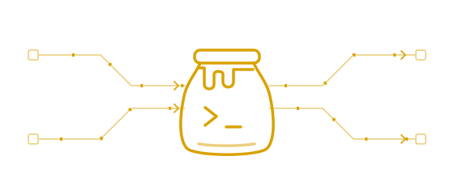
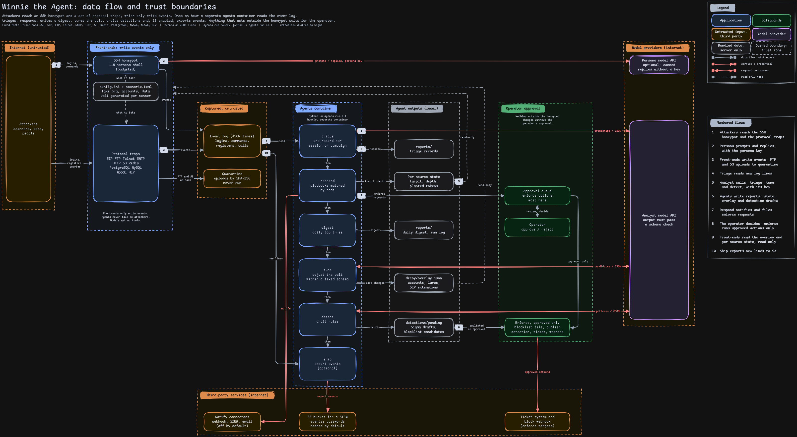
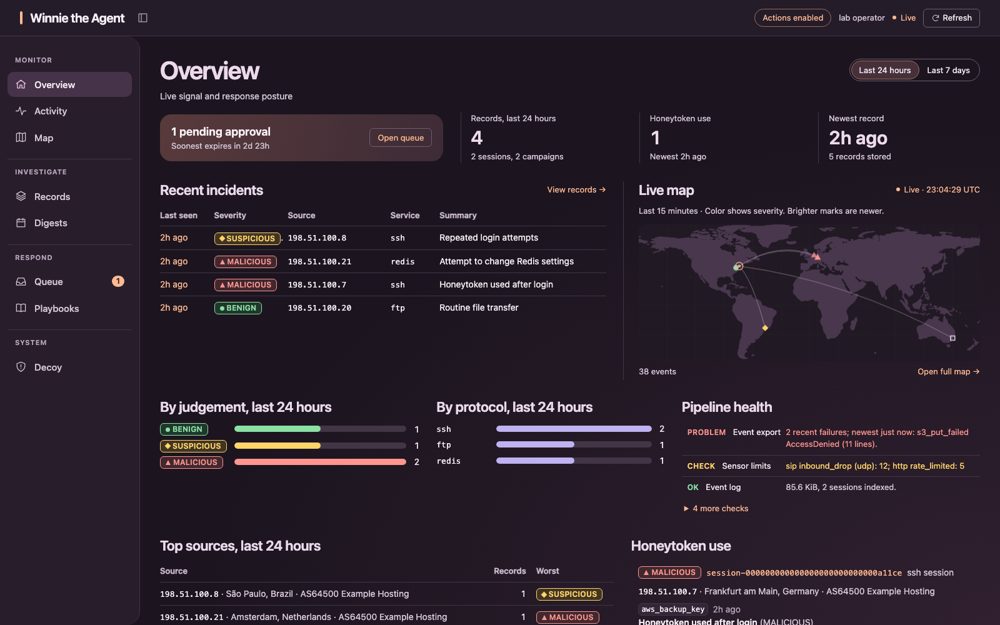

# Winnie the Agent

**Adaptive honeypot and security automation**

<p align="center"></p>

This project is a honeypot sensor built on [DECEIVE](https://github.com/Cisco-Talos/DECEIVE)
by Cisco Talos / Splunk (MIT license). DECEIVE is a high-interaction SSH honeypot in which a
large language model plays the part of a Linux server: there is no real system behind the
shell, only a model answering each command from a system prompt that describes the machine
it should pretend to be.

On top of that SSH honeypot this project adds:

- **Multi-protocol login traps**: SIP (UDP and TCP), FTP, Telnet, PostgreSQL, MySQL, MSSQL,
  Redis, SMTP, HTTP, HL7 v2 over MLLP and an S3-compatible object store. Each one looks
  real long enough to capture
  credentials and intent, then fakes a working service after a fake login.
- **Scenarios**: one TOML file describes the whole fake target (organisation, host, users,
  services, banners, accounts, fake data, HTTP pages and APIs, honeytokens), so every
  protocol on a sensor tells the same story. Seven scenarios ship with the project.
- **Budgets**: every model call first reserves its estimated tokens against per-session,
  per-source and daily token budgets, with concurrency limits, all enforced in code. They
  are estimates, not provider billing, and calls in flight can pass a limit by the
  estimate error.
- **Learned replies**: the decoy shell answers a command from its deterministic shell
  first, then from replies it has learned, and asks the model only for what it has not seen.
  A model reply that came back the same in enough unrelated sessions is stored and served
  from then on, a whole repeated script line by line, across restarts.
  `python -m agents learned` shows the share of commands each step answered and what still
  reaches the model.
- **Triage**: one validated record per SSH session or per trap campaign, plus a daily digest.
- **Where addresses are** (optional): country, city and network owner of each source,
  read from GeoLite2 or DB-IP Lite database files on disk (no network call), stored on
  the triage record and shown in the console and the digest.
- **What Shodan already knows** (optional, off by default): open ports, host names, tags
  and known CVEs that Shodan's public InternetDB holds for interesting sources, looked up
  by the agents (never a honeypot container), or delivered through the object store by a
  lookup outside the sensor, checked as untrusted data and shown in the console. Free for
  non-commercial use.
- **Indicators to OTX** (optional, off by default, dry run until you turn sending on): the
  addresses of proven sources that did more than probe, and the SHA-256 of files they
  uploaded, added to one AlienVault OTX pulse per day. Never attacker-written text. A
  public pulse shows that you run a honeypot; the pulse is private by default.
- **Tuning**: a fenced tuner that adds the fake accounts, SIP extensions and lure files
  attackers actually go for, writing only to a versioned overlay file.
- **Detections**: Sigma rule drafts and blocklist candidates for human review, with a
  processing pipeline onto the sensor's own events.
- **STIX 2.1 export** (optional, off by default): a local bundle of what the sensor saw,
  with indicators only for sources and files that passed promotion or operator approval.
  What has and has not been tested with other tools is in
  [docs/portable-formats.md](docs/portable-formats.md).
- **Response playbooks**: deterministic rules that react to triage records with local
  changes (tarpit, deeper or shallower interaction, per-source honeytokens), notifications
  through opt-in connectors, and enforcement actions that run only after a person approves
  them. Optionally in two steps: a blocklist entry is tracked first, for your cloud to
  watch and report sightings of, and blocked only on a second decision. Winnie publishes
  the lists and your systems pull them; [docs/blocking.md](docs/blocking.md) explains
  Approve and Enforce and how to set up the pull.

> Winnie is used in a live production environment. Review the [deployment guidance](#deployment)
> before setting up your own instance.

## How it fits together



The front-ends write events; the agents read them. Each agents run triages new sessions and
campaigns, runs the response playbooks, writes the digest, tunes the overlay, drafts
detections and, when `[connector.s3_events]` is enabled, finally exports new log lines to
S3 for a SIEM (`python -m agents ship`). Agents never talk
to attackers, and front-ends never write anything the agents produce. Details are in
[docs/architecture.md](docs/architecture.md).

## Quick start (local lab)

The lab is a demo on your own machine. Every port is bound to 127.0.0.1, it needs no
provider keys or cloud accounts, and the walkthrough below takes you from a clone to one
SSH session you can see in the operator console. It is not a deployment: for a sensor on the
internet, read the [isolated-host guidance](docs/operations.md#before-you-deploy) and the
[AWS deployment guide](deploy/aws/README.md).

Requirements: Docker with Compose 2.24.4 or newer (the lab override uses `!override`; check
with `docker compose version`), `ssh-keygen`, and about 1 GB of disk for the image (see
[Known issues](#known-issues)).

```bash
git clone https://github.com/mgrofsky/winnie-the-agent.git
cd winnie-the-agent

# Configuration and SSH host key (both are gitignored)
cp SSH/config.ini.TEMPLATE SSH/config.ini
ssh-keygen -t rsa -b 4096 -N "" -f SSH/ssh_host_key
```

Edit `SSH/config.ini`:

- In `[listeners]`, set `ftp_pasv_address = 127.0.0.1` so FTP passive mode works in the lab.
- In `[scenario]`, pick `active` (default `sip_provider`; see [Scenarios](#scenarios)).
- Optionally change the persona model in `[llm]` (the template selects OpenAI `gpt-4o`).
  Without that provider's API key in the environment, everything still runs: the SSH and
  Telnet shells answer the usual host-sizing commands (`uname`, `uptime`, `free`, `lspci`,
  `nvidia-smi`, `/proc/cpuinfo` and more) from the scenario's host profile, a known tool's
  own error (or nothing) when it is used in a way the shell does not reproduce, and
  `command not found` only for unknown commands, and triage writes deterministic records.

**Linux only, after you have finished editing.** The containers run as uid 10001 and read
`SSH/` through a read-only bind mount, so that user must own the files. Once you hand them
over you need `sudo` to edit them again, which is why this comes last. On macOS and Windows
(Docker Desktop) skip it: Docker Desktop maps ownership itself.

```bash
sudo chown 10001 SSH/config.ini SSH/ssh_host_key
```

Define one shell function and use it for every command below. It works in bash and zsh and
keeps the stack, the console, the logs and the teardown on the same project (`winnie-lab`)
and the same volumes. Run it in each new shell, since a function does not outlive the
shell:

```bash
lab() { docker compose -p winnie-lab -f docker-compose.yml -f docker-compose.lab.yml "$@"; }
```

For the no-key demo, make sure no provider key is set in this shell. Compose passes these
four through by name, and with one set the lab would call that provider (and bill you):

```bash
unset ANTHROPIC_API_KEY OPENAI_API_KEY GOOGLE_API_KEY AZURE_OPENAI_API_KEY
```

(Compose also reads a `.env` file in the repository directory; make sure it sets none of
them.) Then start the stack and the operator console. The lab override binds every port to
127.0.0.1 on a high port:

```bash
lab --profile ui up -d --build
```

*Optional, separate from this walkthrough:* to use a real model, export the key of the
provider you chose in `[llm]` (and `[agents]`) in the shell that runs `lab ... up`, for
example `export OPENAI_API_KEY=...`. It is passed by name and never written to a file. That
path makes paid model calls, and the "zero model calls" result below no longer applies.

Open one SSH session. The `guest` account has an empty password: press Enter when asked.
The first connection also asks you to accept the host key.

```bash
ssh -p 12222 guest@127.0.0.1 'uname -s'      # prints: Linux
```

Then run one analysis pass. The agents container does this every hour; run it now so the
session is processed. Without a provider key it makes no model calls:

```bash
lab exec agents python -m agents run-all --config /config/config.ini --log /data/ssh_log.log --data-dir /data --reports-dir /agents/reports --state-dir /agents/state --detections-dir /agents/detections
```

The summary it prints has `"llm_calls": 0` under `triage`, and the session's id in
`triage.written`: that id is the session record. Note it. To see the record, print the
console's sign-in link and open it in your browser (the console is
`http://127.0.0.1:8480`):

```bash
lab logs ui
```

On the console's Records page, open the record whose id is the one from `triage.written`.
Do not look for a source address: Docker may record its gateway address instead of
`127.0.0.1` for your connection. The Activity page lists the same session's events,
including the `uname -s` input and the answer; search it for the session id. The link
carries a token that signs anyone in, so keep it out of screenshots, issues and chat.

If a lab port is already taken on your machine (HTTP 18080 is a common one; `up` then fails
to bind it), change only the host side (the number before
the container port) of that mapping in `docker-compose.lab.yml`, for example
`"127.0.0.1:12222:8022"` to `"127.0.0.1:12223:8022"`, and use the new number everywhere
below (`ssh -p 12223`, or the console's port in the browser). Running `ssh` against a new
host key later, after `down -v` and a new `ssh-keygen`, warns that the key changed; clear
the old one with `ssh-keygen -R "[127.0.0.1]:12222"`.

| Service | Lab port | Service | Lab port |
|---|---|---|---|
| SSH | 12222 | MySQL | 13306 |
| FTP | 12121 (passive 30000-30019) | PostgreSQL | 15432 |
| Telnet | 12323 | Redis | 16379 |
| SMTP | 12525 | SIP | 15060 (UDP and TCP) |
| HTTP | 18080 | HL7 MLLP | 12575 |
| MSSQL | 11433 | S3 | 19000 |

Only the services enabled by the active scenario answer; nothing listens behind the other ports.

Stop the demo with:

```bash
lab --profile ui down
```

That removes the containers and keeps the volumes, so the captured log, the triage records
and the sensor seed are still there the next time you run `lab --profile ui up -d`. Adding
`-v` (`lab --profile ui down -v`) also deletes the volumes, and with them everything the lab
captured.

### Without Docker

The project uses [uv](https://docs.astral.sh/uv/) for dependencies; `pyproject.toml` and
`uv.lock` are the source of truth.

```bash
uv sync
uv run python SSH/ssh_server.py --config SSH/config.ini          # SSH honeypot
uv run python -m listeners --config SSH/config.ini               # all enabled traps
uv run python -m agents run-all --config SSH/config.ini          # one analysis pass
uv run python -m listeners --list-scenarios
uv run python -m listeners --describe healthcare
```

The SSH server listens on `[ssh] port` (8022 by default, on all addresses unless
`[ssh] listen_host` is set) and stays in the foreground; without a model API key it prints
one warning that sessions get canned replies. The listeners use the scenario's ports (for
example 2121 for
FTP, 8080 for HTTP, 9000 for S3); `[listeners] <service>_port` overrides them.

## Configuration

All settings live in one INI file, `SSH/config.ini`, created from
[`SSH/config.ini.TEMPLATE`](SSH/config.ini.TEMPLATE), which documents every key. Every
section after `[user_accounts]` is optional and has safe defaults.

| Section | What it controls |
|---|---|
| `[honeypot]` | Log file, sensor name, data directory. |
| `[ssh]` | Port, host key, SSH version banner, login, idle and session timeouts. |
| `[llm]` | Persona model provider and model (OpenAI, Azure OpenAI, Ollama, Amazon Bedrock, Gemini, Anthropic), optional temperature, history size, system prompt. |
| `[user_accounts]` | SSH accounts. A blank password allows login without a password; `*` accepts any password. |
| `[budget]` | Line length, commands and tokens per session, tokens per source and globally per day, concurrent sessions. |
| `[scenario]` | Active scenario, optional fixed seed, overlay path. |
| `[listeners]` | Bind address, per-service overrides (`<service>_enabled`, `_port`, `_accept`), connection and rate limits (including the global inbound SIP UDP limit), quarantine caps, FTP passive ports and their timeout and per-source limit, PostgreSQL auth method, SIP UDP slack, optional model fallback for unknown SQL and API requests. |
| `[agents]` | Analyst model and call caps per run and per day, tuner changes per run, triage records per run and record retention. |
| `[respond]` | Response engine: enforcement queue, approval expiry, blocklist file and format, `never_act_on` ranges, proxy guard, notification caps, retention. See [docs/blocking.md](docs/blocking.md) for the blocklist files and how to consume them. |
| `[connector.*]` | Outbound connectors (webhook, siem_http, email, enrich, ticket, block_webhook). All off by default. |
| `[connector.otx]` | Indicators to an AlienVault OTX pulse: proven, active source addresses and upload hashes only. Off by default, and a dry run (written to a file, nothing sent) until `dry_run = false`. See [docs/operations.md](docs/operations.md#indicators-to-otx). |
| `[connector.s3_events]` | Event export: ships the event log to an S3 bucket as JSON lines for a SIEM S3 reader (`python -m agents ship`, also the last step of `run-all`). Off by default; passwords are hashed unless configured otherwise. See [docs/operations.md](docs/operations.md#event-export-to-s3). |

Secrets are never written to the config. API keys and connector credentials are read from
environment variables; the config names the variable (for example
`secret_env = WINNIE_WEBHOOK_TOKEN`). The persona reads its provider's usual variable
(`ANTHROPIC_API_KEY`, `OPENAI_API_KEY`, `GOOGLE_API_KEY`, `AZURE_OPENAI_API_KEY`, or the
AWS profile named in `[llm]`). The analyst agents and the listeners' optional model
fallback use the provider set in `[agents] provider`: the Anthropic API
(`ANTHROPIC_API_KEY`) or Amazon Bedrock (the standard AWS credential chain, such as an
instance role, or the profile named in `[agents]`).

### Telling the SSH persona what to emulate

With a scenario active, the persona gets the scenario's host profile (hostname, OS, users,
lure files and a prompt fragment). Without one, or to add detail, edit `SSH/prompt.txt`
with a short description of the system. It can stay high level:

    You are a video game developer's system. Include realistic video game source and asset files.

or go into detail:

    You are the Internet-facing mail server for bigschool.edu, a state-sponsored university
    in Virginia. Valid user accounts are "a20093887", "a20093887-admin", and "mxadmin".
    Home directories are in "/home/$USERNAME". Everyone's default shell is /bin/zsh, except
    mxadmin's, which is bash. Mail spools for all campus users are in /var/spool/mail.

## Scenarios

| Name | Fake target |
|---|---|
| `sip_provider` | Hosted PBX (FreePBX / Asterisk): SIP, MySQL, FTP config backups, S3 buckets of call recordings, CDR exports and config backups, FreePBX web UI, SMTP, legacy telnet console. |
| `contact_center` | Outsourced contact center on Asterisk: SIP, PostgreSQL CRM, MSSQL, FTP call recordings, agent desktop web app. |
| `bank` | Community bank online banking and core: PostgreSQL core banking, Redis sessions, FTP payment batch drop, S3 statement archive and database backups, banking REST API. |
| `healthcare` | Regional health system EHR integration host: HL7 MLLP, FHIR-style REST API, PostgreSQL clinical database, FTP lab and imaging share. |
| `saas` | Multi-tenant SaaS app server: PostgreSQL, Redis, SMTP relay, S3 uploads, database exports and a misconfigured public bucket, web app and bearer-token API. |
| `api_platform` | B2B data API gateway: versioned REST API with API keys, OpenAPI document, PostgreSQL, Redis. |
| `dev_portal` | Project-workspace web app: JavaScript bundle, source map, runtime config and OpenAPI document that show its API, recovery and activation flows, PostgreSQL. |

Every organisation, person, phone number, card number and domain in them is invented, and a
checker enforces that (`uv run python -m scenarios.check`). The SSH honeypot is available
in every scenario. See [docs/scenarios.md](docs/scenarios.md) for the schema and how to
add one.

The bait is per sensor. The organisation name and domain, host names, internal networks,
people, passwords, password hashes, keys, tokens and session ids in the bundled scenarios
are templates expanded from the sensor's private seed, so none of them is in this
repository and two sensors do not share them. One sensor keeps the same values across
restarts and across all its services: the password in a decoy config file is the one the
database trap accepts. `uv run python -m listeners --describe <name>` shows this sensor's
values. Upgrades that change a bundled scenario or the generators change the bait, so
credentials attackers collected before stop working; see
[docs/operations.md](docs/operations.md#when-the-bait-changes) for what changes and how to
pin a password.

The bundled scenarios are examples. Their story, services, banners and data layout are
the same everywhere and are readable by anyone with the source (see
[docs/security-model.md](docs/security-model.md#fingerprinting)). An operator who wants a
believable target should write their own scenario, or at least pin the identity in the
scenario's `[bait]` table and change the parts that matter to them.

## Export formats

Everything Winnie produces for other systems is a file in a common format. Winnie writes
the files and your systems pull them.

| Format | What it holds | Details |
| --- | --- | --- |
| Sigma rules | Detection rule drafts for a SIEM, written for human review | [docs/portable-formats.md](docs/portable-formats.md) |
| STIX 2.1 bundle | What the sensor saw, with indicators only for sources and files that passed promotion or operator approval. Optional, off by default | [docs/portable-formats.md](docs/portable-formats.md) |
| `tracked.json` | Every live blocklist entry, tracked and enforced, with its status and expiry. The best source for a consumer | [docs/blocking.md](docs/blocking.md) |
| Blocklist file, plain | Enforced addresses, one per line | [docs/blocking.md](docs/blocking.md) |
| Blocklist file, CSV | The same enforced entries with their approval and expiry times | [docs/blocking.md](docs/blocking.md) |
| Blocklist file, nftables | The same enforced entries as address sets that `nft -f` loads | [docs/blocking.md](docs/blocking.md) |

The blocklist file is written in one of the three formats, chosen with
`[respond] blocklist_format`.

## Logs

Every component writes one JSON object per line to the same log (`[honeypot] log_file`,
`/data/ssh_log.log` in Docker). Timestamps are UTC. The `task_name` field identifies one
connection; SSH entries carry `message` values such as `SSH connection received`,
`Authentication success`, `User input`, `LLM response`, `Session summary` and
`SSH connection closed`. `User input` and `LLM response` carry the text base64-encoded in
`details`; `Session summary` carries a `judgement` of `BENIGN`, `SUSPICIOUS`,
`MALICIOUS`, or `UNKNOWN` when no summary was made (for example without a model). Every
entry carries `sensor_protocol` (`ssh` for the SSH server); listener entries add an `event`
type (`connection`, `auth_attempt`, `command`, `register`, `invite`, ...).

**The log contains every username and password attackers submit, in plain text.** See
[docs/architecture.md](docs/architecture.md#logging-contract) for the full format.

## Operator console

A local web console for the operator: pipeline health, the approval queue, triage records
with SSH transcript replay, digests, tuner state, playbooks and detections. It is
read-only by default, listens on 127.0.0.1:8480 only, and never calls a model.



```bash
python -m agents ui                       # without Docker
lab --profile ui up -d ui                 # the lab, with the `lab` function from the quick start
lab logs ui                               # prints the sign-in link (a secret: keep it out of screenshots)
```

For a stack started without the lab override, use `docker compose --profile ui up -d ui` and
`docker compose logs ui` from the same directory and project.

On a remote host, reach it with `ssh -L 8480:127.0.0.1:8480 <host>`. Sign-in, actions
(approve, reject, unblock) and the AWS setup are in
[docs/operations.md](docs/operations.md#operator-console).

## Safety design

- **No real system.** The SSH and Telnet shells are model output or canned text. The
  listeners run nothing they receive: SQL goes to an in-memory fake engine, Redis `SAVE`
  writes nothing, SMTP never relays, SIP never places or bridges a call.
- **Front-ends do not connect out.** FTP active mode (`PORT`/`EPRT`) is refused, Redis
  `SLAVEOF` never dials, SMTP opens no outbound socket. Apart from replies to clients, the only outbound
  traffic a front-end produces is model API calls, if a model is configured. Tokens for
  history trimming are counted locally, so no tokenizer is ever downloaded.
- **Uploads are quarantined.** FTP uploads are stored once per SHA-256 with mode 0600,
  under per-file, per-source and total caps, and are never read back or executed.
- **Budgets in code.** Every model call reserves its estimated token cost first, against
  per-session, per-source and host-wide daily limits (estimates, not provider billing); when a limit is
  reached the model is not called and the attacker gets a canned error. Known commands are
  answered by a deterministic shell without the model, a session gets at most 50 model
  answers (then the shell answers the rest), and a bot replaying a script another session
  already ran, with an identical history, gets the cached replies instead of new model
  calls. A command whose model reply was the same in enough unrelated sessions is then
  answered from the learned replies with no model call (`python -m agents learned`).
- **The model cannot steer the system.** Models get no tools, files or network. Analyst
  output must validate against strict schemas; the tuner only picks from candidates the
  code generated; playbooks are matched and executed by code. Attacker text reaches
  analysts only inside a randomly delimited block.
- **Enforcement needs a person.** Actions that change something outside the honeypot
  (blocklist export, publishing a detection, opening a ticket, calling a block webhook) are
  only queued, and only when `[respond] queue_enforce = true`. They run after
  `python -m agents approve <id>`, and approvals expire.
- **Spoofable and internal sources are left alone.** UDP sources that never answered a SIP
  nonce, non-global addresses and `never_act_on` ranges get no per-source action of any
  kind.
- **Hardened containers.** Non-root user, read-only root filesystem, all capabilities
  dropped, `no-new-privileges`, and separate volumes for what the front-ends write and
  what the agents write.

The full threat model is in [docs/security-model.md](docs/security-model.md).

## Deployment

Read [docs/operations.md](docs/operations.md) before deploying. For AWS,
[deploy/aws/README.md](deploy/aws/README.md) is a worked example: CloudFormation templates
for one sensor host with no outbound route and a write-only events bucket in another
account, with a containment checklist (and an optional tailnet for the operator console). Its
optional model access on Amazon Bedrock for the persona and the analyst (a second stack,
`deploy/aws/models.yaml`) has been run once on a real account; the guide says what was
seen and what is still unproven. In short:

- **Run it isolated.** Put the sensor on a dedicated host or VM in its own network segment
  with no route to anything you care about. Block outbound traffic from the front-ends at
  the host firewall; they need egress only for the persona model API, if you use one.
  `docker-compose.isolated.yml` shows the no-egress layout for testing.
- **Client addresses.** Disable Docker's userland proxy (or use host networking for the
  front-ends). Otherwise every connection appears to come from the Docker gateway, and
  per-source limits, logs and blocklists are useless.
- **Legal and policy responsibility is yours.** Operating a honeypot means recording
  traffic and credentials from third parties. Whether and how you may do that depends on
  your jurisdiction, your hosting provider's terms and your organisation's policies.
  Check before you deploy.
- **SIP and HL7 traps in particular.** The SIP trap answers registrations and calls on a
  well-known VoIP port; even though it never places a call, it attracts toll-fraud
  traffic, and some providers and networks restrict hosting it. Over UDP it is built not
  to amplify (responses are never larger than requests by default), but spoofed traffic
  can still make it send packets to third parties within the rate caps. The HL7 trap
  impersonates a clinical interface; inbound messages may contain what looks like (or,
  from a misdirected real system, is) patient data. Do not expose it where real HL7
  senders could reach it by mistake.
- **Captured credentials are sensitive data.** The event log, `reports/`, the quarantine
  and the approval queue hold attacker-supplied text and plain-text passwords, some of
  which will be real credentials reused from elsewhere. Restrict access, rotate and
  delete the log on a schedule, and decide how long you keep reports. The response engine
  prunes its own run records and approvals (`[respond] retention_days`) and triage prunes
  its session and campaign records (`[agents] record_retention_days`); nothing prunes the
  event log or digests for you.

## Known issues

- **MSSQL without TLS.** The MSSQL trap does not offer encryption, so clients that require
  it (the ODBC 18 default) are logged and refused.
- **The fake file system is per session.** The model makes up the host's files as a session
  goes on, so a file listed in one session may be missing in the next one from the same
  source.
- **Approximate token counts.** SSH history trimming and budgets count tokens locally (four
  ASCII characters per token, non-ASCII text weighted higher), so `[llm]
  trimmer_max_tokens` is an estimate rather than the provider's exact count.
- **Image size.** The Docker image is about 650 MB on disk, mostly the Python base image
  and the model provider client libraries. See
  [docs/operations.md](docs/operations.md#image-size-and-token-counting).
- **Invented commands are handled.** A chat model playing a shell can carry on past the
  prompt, type a command the client never sent and answer it. This is a known behaviour and
  Winnie handles it: every model reply is cut back to the output of the one input and one
  prompt before it is sent, stored or cached, and each cut is logged as a `Reply cut`
  event, so you can see how often it happens. A reply to an input that can print a
  prompt-shaped line itself (it contains `@`, `$`, a backtick, a backslash or `%`) is left
  whole rather than risk cutting real output.
- The daily budget is shared between processes on one host through a file lock; several
  hosts do not share one cap.
- Changing the SSH banner or the active scenario needs a restart.

## Tests

```bash
uv sync
uv run pytest                        # skips the slow timing and scale tests
uv run pytest -m "(slow or not slow) and not browser"  # everything but the browser tests, as CI runs it
```

No test touches the network beyond loopback, and none calls a real model. The SSH
integration tests start the real server on a random local port and use a deterministic fake
model. See [CONTRIBUTING.md](CONTRIBUTING.md).

The security workflow adds Playwright tests of the operator console in Chromium, an OWASP
ZAP baseline and active scan of the console on loopback, Ruff's security rules and a
pip-audit of `uv.lock`; [CONTRIBUTING.md](CONTRIBUTING.md#security-checks) shows how to run
each locally.

## Security

To report a vulnerability, see [SECURITY.md](SECURITY.md).

## License

MIT. See [LICENSE](LICENSE). This project is based on
[DECEIVE](https://github.com/Cisco-Talos/DECEIVE) by Cisco Talos / Splunk, released under the
MIT License; the original copyright notice is kept in `LICENSE`.
