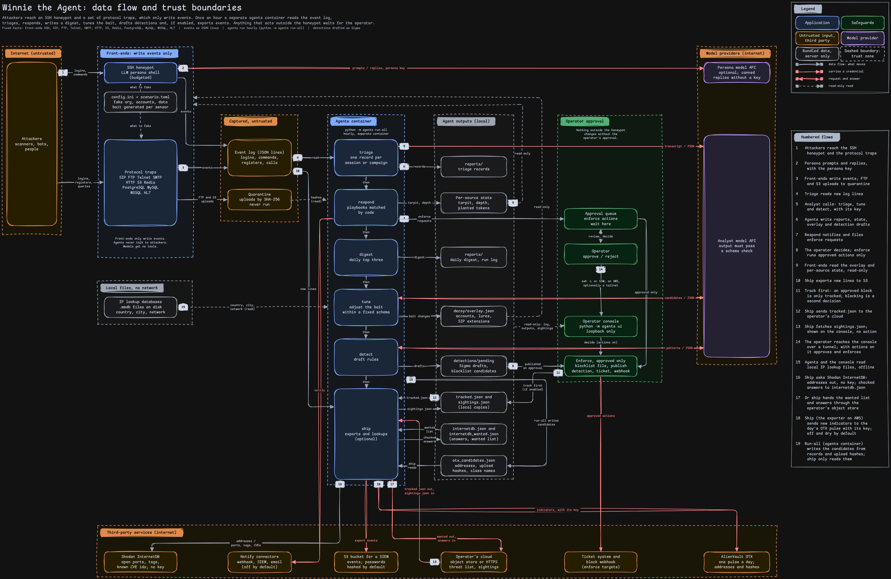

# Data-flow diagram

A light version ([winnie-dataflow-light.png](winnie-dataflow-light.png)) and SVG versions of both
are in this folder.

## How to read it

Data moves left to right. The numbered tabs mark the flows listed in the image's own panel.

- **Attackers** reach the SSH honeypot and the protocol traps. Everything they send is untrusted.
- **Front-ends** capture events and uploads. They never call the agents.
- **Agents** run in a separate container on a timer: triage, respond, digest, tune, detect and
  ship. They read the captured data as untrusted input and never talk to attackers.
- **Agent outputs** are local files. The front-ends read some of them back, read-only.
- **Operator approval** gates enforce actions: the blocklist, publishing a detection, the ticket
  system and the block webhook.
- **Models** get no tools, and the analyst model's answers must pass a schema check.
- **Outbound connectors** are optional and disabled by default. Whatever comes back is untrusted.

Blue is application code, green is a safeguard, amber is untrusted input or a third party,
purple is a model provider, and gray is local or read-only data. A dashed rectangle is a
trust boundary. A red arrow carries a credential. A dashed gray arrow is a read-only read.

## Where the labels are shorter than the behavior

- **"Front-ends only write events."** They also store uploads in quarantine, and the SSH
  honeypot can call the persona model.
- **"Nothing outside the honeypot changes without the operator's approval."** That covers
  enforce actions. Notifications, exports, lookups and OTX submission run without approval once
  enabled in the configuration.
- **"(internet)" on the provider zones** means outside the sensor. A provider can also be a
  service on a private endpoint or a local model.
- **"Agents run hourly"** is the default interval, and it is configurable.
- **Event export** (`[connector.s3_events]`) writes to an S3 bucket only.

See [architecture.md](../architecture.md), [security-model.md](../security-model.md) and
[operations.md](../operations.md) for the detail behind each flow.
